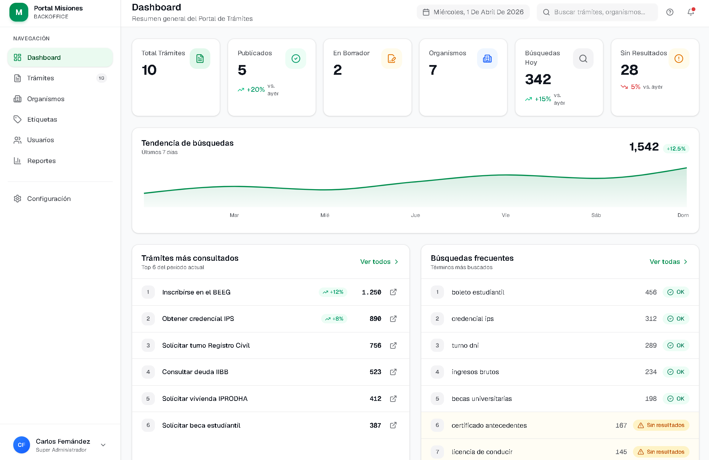

# Portal Provincial de Tramites - Misiones

Portal de tramites provinciales para la **Subsecretaria de Gobierno Inteligente** - Vicegobernacion de Misiones.

Monorepo con dos aplicaciones frontend independientes consumiendo la misma API REST.



## Estructura del proyecto

```
PortalMisiones/
├── backoffice/          # Panel de administracion (Angular 17)
├── public/              # Portal publico ciudadano (Next.js 15)
├── shared/types/        # TypeScript interfaces compartidas
└── docs/                # Documentacion del proyecto
```

## Aplicaciones

### Backoffice - Panel de Administracion

Panel interno para la gestion de tramites, organismos y usuarios.

**Stack:** Angular 17 (standalone components) · Angular Material · SCSS

**Funcionalidades:**
- Dashboard con estadisticas y metricas
- ABM de tramites (crear, editar, publicar, despublicar)
- ABM de organismos
- Gestion de usuarios con roles (SUPERADMIN, ADMIN_ORGANISMO, EDITOR)
- Workflow de estados: borrador → revision → publicado ↔ despublicado

```bash
cd backoffice
npm install
npx ng serve        # http://localhost:4200
```

### Portal Publico - Portal Ciudadano

Portal de consulta publica para ciudadanos. Catalogo de tramites provinciales con busqueda y filtrado.

**Stack:** Next.js 15 · React 19 · Tailwind CSS 4 · App Router

**Funcionalidades:**
- Pagina principal con tramites destacados y buscador
- Catalogo de tramites con filtros por organismo, modalidad y etiqueta
- Detalle de tramite con requisitos y pasos
- Busqueda con normalizacion de acentos

```bash
cd public
npm install
npm run dev         # http://localhost:3000
```

## Roles y permisos

| Rol | Tramites | Organismos | Usuarios |
|-----|----------|------------|----------|
| SUPERADMIN | Todos | CRUD | Ver todos |
| ADMIN_ORGANISMO | De su organismo | Ver | De su organismo |
| EDITOR | Crear/Editar | Ver | - |

## Requisitos

- **Node.js** 20.11.0
- **npm** 10+

## Tech Stack

| | Backoffice | Portal Publico |
|---|---|---|
| **Framework** | Angular 17 | Next.js 15 |
| **UI** | Angular Material | Tailwind CSS 4 |
| **Lenguaje** | TypeScript 5.4 | TypeScript 5.8 |
| **Estilos** | SCSS + CSS Variables | Tailwind + CSS Variables |
| **Componentes** | Standalone + NgModule | React Server Components |

## Convenciones

- UI y modelos en **espanol**
- Locale: **es-AR**
- Formato de fecha: **DD/MM/YYYY**
- Fuente backoffice: **Poppins**
- Titulos de tramites inician con verbo en infinitivo (Obtener, Inscribirse, Solicitar)
- Tema principal: verde Misiones (`#1B5E20` backoffice / `#0d6b45` portal)
